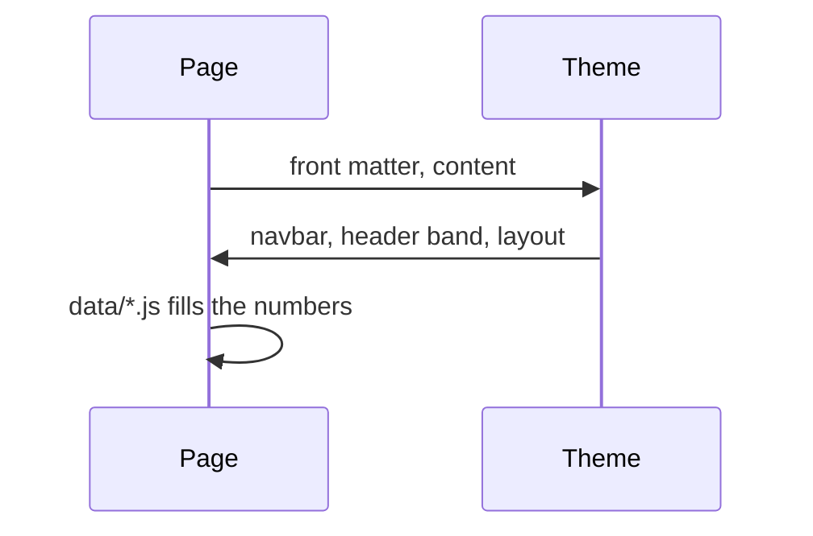
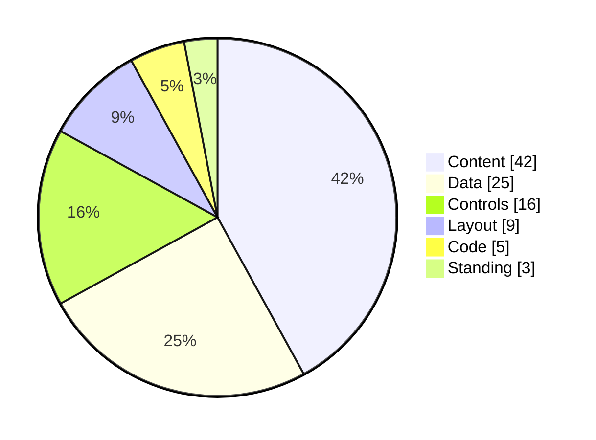

## Code

*A fenced block in Markdown, coloured at build time by Pygments through pymdownx.highlight, in any language it knows. Every block has a copy button, shown when the pointer is over it.*

```python
def wrap_sections(html: str) -> str:
    parts = SECTION.split(html)
    if len(parts) == 1:
        return html
    return "".join(card(*parts[i:i + 3]) for i in range(1, len(parts), 3))
```

A header naming the file is opt-in. Give one block a title on its fence, `` ```python title="source/almanac/plugin.py" ``:

```python title="source/almanac/plugin.py"
def lexicon_script(entries: list[dict]) -> str:
    return f"window.ALMANAC_DATA.lexicon = {json.dumps(entries)};\n"
```

To give every block a header, naming its language when it has no title, set `auto_title: true` under `pymdownx.highlight` in `mkdocs.yml`.

## A quote from the source

*A block naming the file and lines it quotes, with a copy button. Coloured in the browser for C, C++ and CMake.*

```example
<div class="code-block"><pre class="highlight" data-lang="cpp"><code data-source="source/geometry/shape.hpp" data-lines="12-17">class Shape {
 public:
  virtual ~Shape() = default;
  // The area the outline encloses, in square units.
  virtual double area(std::span&lt;const Point&gt; outline) const = 0;
};</code></pre></div>
```

The quoted lines are written into the page by the project's own tooling, which rereads them from the source, so the page is refreshed when the code moves.

## Diagrams

*A mermaid fence, drawn in the browser in the theme's colours and face, and drawn again when the reader changes them. Mermaid ships with the theme, so a site opened from disk draws it.*



*A chart's series take the primary first, then the palette's other hues in turn.*



## Maths

*TeX between dollars, typeset in the browser by KaTeX, which ships with the theme, so a site opened from disk draws it.*

```markdown
The area of a circle of radius $r$ is $\pi r^2$, and a sum of the first $n$ odd numbers is a square:

$$
\sum_{k=1}^{n} (2k - 1) = n^2
$$
```

The area of a circle of radius $r$ is $\pi r^2$, and a sum of the first $n$ odd numbers is a square:

$$
\sum_{k=1}^{n} (2k - 1) = n^2
$$

Name `pymdownx.arithmatex` with `generic: true` in `mkdocs.yml`; the theme loads KaTeX only on a page that has maths.

## Examples

*A block of HTML drawn live with its markup beneath, as on these pages.*

Written as an `example` fence, which the plugin's `almanac.fences.example_format` draws; `mkdocs.yml` names it among `pymdownx.superfences`' custom fences, as [Setting up](../setting-up.md) shows. A script inside the block runs where it stands.

## Icons

*Any of Tabler's five thousand outline icons, by name, drawn inline in the text's colour.*

The theme draws a section's icon in the navbar and on the map from the theme's `sections` option, `{Guide: {icon: book}}`, by the names at [tabler.io/icons](https://tabler.io/icons). The icons ship with the plugin, not the site: only those a page uses are drawn into it.
