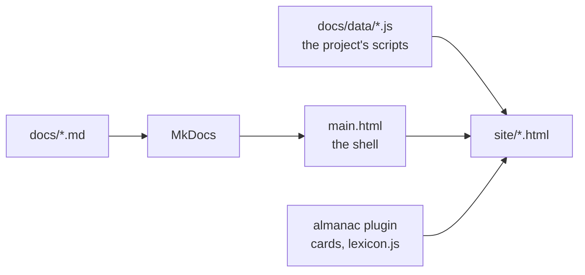

Almanac draws an MkDocs site in the look of Tabler's dashboard: a navbar with a menu for each section of the site's `nav`, a header band naming the page, and the content on raised surfaces. The site opens from disk with no server, so its data, its lexicon and its diagrams come as scripts beside the pages.

The stylesheets and scripts behind it are a kit of their own. A project that is not a site, a dashboard or a small app written as plain HTML, copies the kit in and gets the same look and components: [Pages by hand](kit.md).

## Two layouts

A page picks its body with `layout` in its front matter.

- **docs**, the default: the article as prose on one surface, with the page's contents in a column beside it that marks the section being read. On a narrower window the column gives way to a floating button.
- **cards**: each `##` section a card, for a page of figures and panels. The [components](components/content.md) are drawn that way.

The site's navigation is a navbar across the top, as here, or a sidebar down the left.

## What it carries

- The components under Components, each drawn live with its markup: alerts, tables, charts, tabs, drawers and the rest, and the light, dark and accent settings in the navbar.
- A [dashboard](components/dashboard.md)'s pieces: canvas charts with a legend and a table view, KPI cards, a period control that steps a page by month, week or day, and a table filter.
- A page that takes input: [buttons, forms, dialogs, popovers, toasts, menus and pagination](components/forms.md), [card extras, accordions, loading states and the rest](components/cards.md), laid out on a [twelve-column grid](components/grid.md) with Bootstrap's utilities.
- [Three libraries](components/libraries.md) in the theme's look, each loaded only where it is used: a drop zone for files, a month of events, and a rich-text field.
- Numbers bound to data: `` shows , read from a script the project writes.
- The lexicon's words explained where a page first uses them, as the layout and the header band are here.
- Mermaid diagrams, drawn in the browser in the theme's own colours and face.

## The map

This page carries `map: true`, which draws the site's map under it: a card for each section, its pages with their descriptions, and a lit dot for a page's [standing](components/standing.md).
